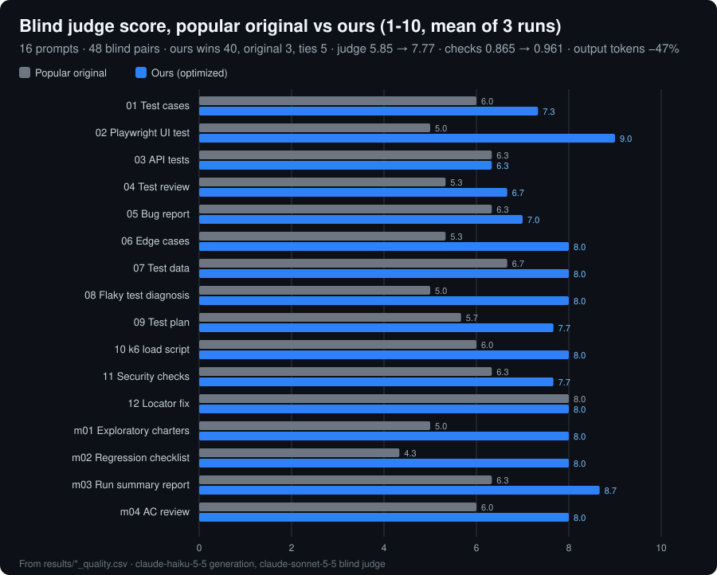

<p align="center">
  
</p>

<p align="center">
  <strong>33 AI prompts for software testers, tested like code</strong><br/>
  <strong>Manual testing • Automation testing • Industry packs</strong><br/>
  <sub>Copy-paste prompts for ChatGPT, Claude, Copilot and Cursor. Each one is scored against the popular version it replaces, with real checks and a blind judge.</sub>
</p>

<p align="center">
  <a href="LICENSE"></a>
  
  
  
  <a href="https://github.com/sprintsynergyio/qa-prompt-pack/actions/workflows/eval.yml"></a>
</p>

<p align="center">
  &nbsp;
  &nbsp;
  &nbsp;
  
</p>

<p align="center">
  <a href="#manual-testing-11">Manual testing</a> · <a href="#automation-testing-6">Automation testing</a> · <a href="#industry-16">Industry</a> · <a href="results/results.md">Full results</a> · <a href="#how-it-works">How it works</a> · <a href="https://sprintsynergy.com">SprintSynergy</a>
</p>

# QA Prompt Pack

**⭐️ NEW:** the [manual testing pack](#manual-testing-11) adds exploratory charters, a regression checklist from a release change list, a test run summary with go/no-go, an acceptance-criteria review and a cross-browser/device matrix. [Results →](results/manual.md)

QA Prompt Pack is a set of 33 prompts for the tasks testers hand to AI most: test cases, bug reports, test plans, Playwright and API tests, flaky-test diagnosis, k6 scripts, and domain checks for healthcare, financial, e-commerce and SaaS. All of them are MIT-licensed.

**Every prompt is tested, not just written.** Each one runs 3 times on the same input. The output is scored by deterministic checks (does the code compile and pass on a live demo? are the totals right? did it catch the planted contradiction?) and by a blind judge model that never sees either prompt.

<table>
<tr>
<td width="40%" valign="middle">

### Better answers, not shorter prompts

Across the 16 prompts that have a popular public original (48 blind pairs), **ours wins 40, the original 3, ties 5**.

- Judge score **5.85 → 7.77**
- Deterministic checks **0.865 → 0.961**
- Output tokens **−47%**

The prompts themselves are about the same length (input +3%). The gain is in the answers.

</td>
<td width="60%">



</td>
</tr>
<tr>
<td width="40%" valign="middle">

### Tested like code

Automation answers must compile with `tsc` and pass against the live [TodoMVC demo](https://demo.playwright.dev/todomvc/) and [JSONPlaceholder](https://jsonplaceholder.typicode.com).

Manual answers are checked against synthetic inputs with planted traps.

The whole evaluation cost **$2.29** on Claude.

</td>
<td width="60%">

| Pack | Prompts | Result |
|---|---|---|
| Manual testing | 11 | 10 beat the original, 0 lost; m05 3/3 runs pass |
| Automation testing | 6 | 5 beat, 1 matched, 0 lost |
| Industry | 16 | 48/48 runs pass, judge 7.5/10 |

</td>
</tr>
</table>

---

## Quick start

1. Pick a prompt below (or browse [`prompts/`](prompts/)).
2. Replace the `{{file}}` slot with your own story, notes, test results or page snapshot.
3. Paste it into ChatGPT, Claude, Copilot or Cursor.

For example, the [bug-report prompt](prompts/optimized/05_bug_report.txt):

```
Bug report from these notes. Facts from notes only; missing = "Unknown"; guessed steps tagged [unconfirmed].
Output only: Title (component - symptom), Severity H/M/L + 1-line reason, Environment, Steps, Expected, Actual, Questions (max 4, most blocking first).
<notes>
{{bug-notes.md}}
</notes>
```

### Try it

```
prompts/optimized/05_bug_report.txt            # rough notes → bug report a developer can act on
prompts/manual/optimized/m03_run_summary.txt   # raw run results → summary with go/no-go
prompts/optimized/02_ui_script.txt             # user journey + aria snapshot → Playwright test
```

---

## Manual testing (11)

Checks 0-1 and judge 1-10, popular original → ours, mean of 3 runs.

| # | Prompt | Checks | Judge | Wins (ours/orig/tie) |
|---|---|---|---|---|
| 01 | [Test cases from a user story](prompts/optimized/01_test_cases.txt) | 0.80 → 1.00 | 6.0 → 7.3 | 2/1/0 |
| 05 | [Bug report from rough notes](prompts/optimized/05_bug_report.txt) | 1.00 → 1.00 | 6.3 → 7.0 | 2/1/0 |
| 06 | [Edge-case inputs](prompts/optimized/06_edge_cases.txt) | 0.96 → 0.93 | 5.3 → 8.0 | 3/0/0 |
| 07 | [Test data](prompts/optimized/07_test_data.txt) | 0.78 → 0.75 | 6.7 → 8.0 | 2/0/1 |
| 09 | [Test plan](prompts/optimized/09_test_plan.txt) | 1.00 → 0.96 | 5.7 → 7.7 | 3/0/0 |
| 11 | [Security checks](prompts/optimized/11_security.txt) | 0.96 → 0.99 | 6.3 → 7.7 | 2/0/1 |
| m01 | [Exploratory testing charters + session notes](prompts/manual/optimized/m01_exploratory_charters.txt) | 0.77 → 0.96 | 5.0 → 8.0 | 3/0/0 |
| m02 | [Regression/smoke checklist from a release change list](prompts/manual/optimized/m02_regression_checklist.txt) | 0.93 → 1.00 | 4.3 → 8.0 | 3/0/0 |
| m03 | [Test run summary report (go/no-go)](prompts/manual/optimized/m03_run_summary.txt) | 0.91 → 1.00 | 6.3 → 8.7 | 3/0/0 |
| m04 | [Acceptance-criteria review before testing](prompts/manual/optimized/m04_ac_review.txt) | 0.71 → 1.00 | 6.0 → 8.0 | 3/0/0 |
| m05 | [Cross-browser/device test matrix](prompts/manual/optimized/m05_browser_matrix.txt) (standalone) | 1.00, 3/3 pass | 8.0 (absolute) | n/a |

- Originals: [`prompts/original/`](prompts/original/) and [`prompts/manual/original/`](prompts/manual/original/), quoted with credit in [SOURCES.md](SOURCES.md).
- Manual inputs (`inputs/m-*.md`) are synthetic and contain planted traps. In one, a lead's note counts blocked cases as executed (m03). In another, two acceptance criteria contradict each other (m04).
- Where ours is weaker:
  - 07 and 09 score slightly lower on the checks but win the judge.
  - m03 writes longer answers than the original (2,112 vs 1,509 output tokens per run), because it recomputes every total.

Details: [results/manual.md](results/manual.md) · [results/manual_summary.md](results/manual_summary.md)

---

## Automation testing (6)

| # | Prompt | Checks | Judge | Wins (ours/orig/tie) |
|---|---|---|---|---|
| 02 | [Playwright UI test from a user journey](prompts/optimized/02_ui_script.txt) | 0.71 → 0.93 | 5.0 → 9.0 | 3/0/0 |
| 03 | [API tests (Playwright request)](prompts/optimized/03_api_tests.txt) | 0.69 → 1.00 | 6.3 → 6.3 | 2/1/0 |
| 04 | [Review a test file](prompts/optimized/04_test_review.txt) | 0.75 → 0.85 | 5.3 → 6.7 | 3/0/0 |
| 08 | [Flaky / failing test diagnosis](prompts/optimized/08_flaky.txt) | 0.87 → 1.00 | 5.0 → 8.0 | 3/0/0 |
| 10 | [k6 load script](prompts/optimized/10_load_script.txt) | 1.00 → 1.00 | 6.0 → 8.0 | 3/0/0 |
| 12 | [Locator fix](prompts/optimized/12_locator_fix.txt) | 1.00 → 1.00 | 8.0 → 8.0 | 0/0/3 |

- Code answers must compile and pass against the live demo. k6 scripts must pass `k6 inspect`, and locators must match the right element on the real page.
- The general tasks (01-12) were picked by how often they appear in 34 public prompt sources ([research/](research/)).

Details: [results/results.md](results/results.md) · [results/summary.md](results/summary.md)

---

## Industry (16)

Written for this pack, so there is no public original to A/B against. They are scored on their own: deterministic domain checks plus a judge rubric. **48 of 48 runs pass; mean judge 7.5/10; weakest: fi04 audit trail (judge 6).** All fixtures are synthetic. Card numbers are documented test numbers and SSNs come from reserved ranges.

| Domain | Prompts |
|---|---|
| Healthcare | [hc01 PHI-safe synthetic test data](prompts/industry/hc01_phi_testdata.txt) · [hc02 Appointment and prescription flows](prompts/industry/hc02_clinical_flows.txt) · [hc03 PHI leakage in logs, UI and API](prompts/industry/hc03_phi_leakage.txt) · [hc04 WCAG 2.2 AA for a patient portal](prompts/industry/hc04_accessibility.txt) |
| Financial | [fi01 Rounding, currency and precision](prompts/industry/fi01_rounding_currency.txt) · [fi02 Payment and refund flows](prompts/industry/fi02_payment_refund.txt) · [fi03 Fraud and transaction limits](prompts/industry/fi03_fraud_limits.txt) · [fi04 Audit trail](prompts/industry/fi04_audit_trail.txt) |
| E-commerce | [ec01 Cart and checkout edge cases](prompts/industry/ec01_cart_checkout.txt) · [ec02 Discounts, tax and coupons](prompts/industry/ec02_discounts_tax.txt) · [ec03 Inventory race conditions](prompts/industry/ec03_inventory_race.txt) · [ec04 Peak-load k6 script](prompts/industry/ec04_peak_load.txt) |
| SaaS | [sa01 RBAC permission matrix](prompts/industry/sa01_rbac_matrix.txt) · [sa02 Multi-tenant isolation](prompts/industry/sa02_tenant_isolation.txt) · [sa03 Subscription billing proration](prompts/industry/sa03_billing_proration.txt) · [sa04 API contract tests](prompts/industry/sa04_api_contract.txt) |

Details: [results/industry.md](results/industry.md) · [results/industry_summary.md](results/industry_summary.md)

---

## Features

- **No role line.** "You are a senior QA engineer…" costs tokens and doesn't make structured output better.
- **Input in tags** (`<req>`, `<notes>`, `<results>`, `<snapshot>`), so instructions and data don't blur.
- **"Output only…"** with an exact table or code-block format. No intro, no recap.
- **Hard caps** (max 20 rows, max 5 questions) stop near-duplicate cases.
- **No guessing.** Missing facts become "Unknown", `[unconfirmed]` or a question. Undefined behavior becomes `test.fixme` with a reason.
- **Self-checking.** The run-summary prompt recomputes every total from the module rows and flags any stated figure that doesn't match.
- **Real locators.** UI prompts get the page's Playwright aria snapshot (184 tokens vs 317 for raw HTML) and ban CSS/XPath/`nth`/`waitForTimeout`.
- **Only what applies.** No "auth bypass" cases for an app with no login. Docs-only changes are skipped with a reason.

---

## How it works

### A/B prompts (manual + automation)

```
Popular original + our version, same input
  -> claude-haiku-5-5 generates 3 answers each
  -> Deterministic checks: tsc + live Playwright, k6 inspect, live locator match,
     recomputed totals, planted-trap coverage, invented IDs
  -> claude-sonnet-5-5 judges each pair blind, in random order,
     against a neutral task statement (it never sees either prompt)
  -> results/*_quality.csv -> summary.md, verdicts.json
```

### Standalone prompts (industry + m05)

```
Our prompt, synthetic domain fixture
  -> 3 answers
  -> Domain checks (exact rounding, 404 not 403 cross-tenant, reserved SSNs, documented test cards)
  -> One absolute judge call over all 3 runs (score + consistency)
  -> A run passes at checks >= 0.8
```

<details>
<summary>Why the judge gets a neutral task, not the original prompt</summary>

In the first run, the judge was given the original prompt as the task. It then graded both answers against the original's own wording ("Python CSS selector", "at least 2 security cases", "unicode"), which rewards following that wording rather than usefulness. In that setup the original won 31 of 36. Both judgments are kept: [results/judge_neutral.json](results/judge_neutral.json) and [results/judge_original_spec.json](results/judge_original_spec.json). Reproduce with `--judge-spec original`.

</details>

<details>
<summary>What we fixed after the first run</summary>

- Four of our prompts (edge cases, test plan, security, test data) lost on the checks at first. We fixed them and re-ran each 3 times.
- The model miscounted "200-character" strings with either prompt, so the test-data prompt now carries the literal string.
- One of our own checks marked a correct answer wrong. We fixed it and re-scored both variants.

All of it is listed in [results/results.md](results/results.md) and [results/manual.md](results/manual.md).

</details>

---

## Run the eval yourself

```bash
pip install -r eval/requirements.txt
(cd eval/harness && npm install && npx playwright install chromium)
python eval/count_tokens.py
export ANTHROPIC_API_KEY=...            # never commit it

BUDGET_USD=3 K6_BIN=/path/to/k6 python eval/run_eval.py --runs 3                    # general (01-12)
BUDGET_USD=1 python eval/run_eval.py --suite manual --runs 3                          # manual (m01-m05)
BUDGET_USD=1 K6_BIN=/path/to/k6 python eval/run_eval.py --suite industry --runs 3   # industry
python eval/summarize.py --suite general   # or manual / industry
```

Self-tests (no API key needed):

```bash
python eval/selftest.py
python eval/manual_selftest.py
python eval/industry_selftest.py
```

On GitHub, add the repo secret `ANTHROPIC_API_KEY` (or `MODELS_API_KEY`) and trigger **Actions → prompt-eval** or **prompt-eval-industry**. Without a secret, the workflow runs only the self-tests.

### Configuration

| Variable / flag | Description |
|---|---|
| `ANTHROPIC_API_KEY` | Key for `claude-*` models (default) |
| `EVAL_MODEL` / `--model` | Generation model (default `claude-haiku-5-5`) |
| `EVAL_JUDGE` / `--judge` | Judge model (default `claude-sonnet-5-5`) |
| `BUDGET_USD` | Stops before a call would push spend past this (default 3) |
| `SPEND_FILE` | Where spend is recorded (default `runs/spend.json`) |
| `K6_BIN` | Path to `k6` for load-script checks |
| `MODELS_URL` + `MODELS_API_KEY` | Any OpenAI-compatible endpoint, for non-Claude model ids |
| `--suite general\|manual\|industry` | Which pack to run |
| `--tasks 07,m03` | Run only some prompts |
| `--score-only` | Re-score and judge only new outputs (no generation) |
| `--judge-spec original` | Judge against the original prompt text instead of the neutral task |

Token counts use `tiktoken` (o200k_base) plus the API's own usage numbers.

---

## Repo layout

```
prompts/original/            popular originals (general), quoted with credit
prompts/optimized/           our general prompts 01-12
prompts/manual/original/     popular originals (manual), quoted with credit
prompts/manual/optimized/    our manual prompts m01-m05
prompts/industry/            our industry prompts (16)
inputs/                      TodoMVC DOM + aria snapshot, JSONPlaceholder API, synthetic m-*, hc-*, fi-*, ec-*, sa-* fixtures
eval/                        harness: run_eval.py, judge_tasks.py, manual_score.py, industry_score.py, self-tests
results/                     results.md, manual.md, industry.md, per-run CSVs, judge files, token counts
research/                    source × task matrix, industry research notes
```

---

## Contributing

If a prompt fails on your app, [open an issue](https://github.com/sprintsynergyio/qa-prompt-pack/issues) with the input and the output. That helps us more than a star. PRs with a new prompt should include a synthetic input, a check in `eval/`, and a 3-run result.

Built by [SprintSynergy](https://sprintsynergy.com), an AI-based QA automation company (AI testing agents plus our QA team).

---

## License

MIT for everything we wrote (optimized prompts, manual and industry prompts, inputs, harness, results). See [LICENSE](LICENSE). The quoted originals belong to their authors; see [SOURCES.md](SOURCES.md).
